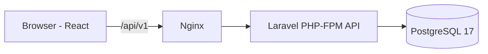

# Foundation architecture

RestaurantOS starts as a modular monolith: React + Vite front end, Laravel API and PostgreSQL.

Only `/api/v1/health` and `/api/v1/ready` business-independent endpoints exist. There is no tenant-owned data or private API in the foundation. Future modules (Identity, Tenancy, Restaurants, Menus, QR, Billing, Orders) remain planned. Tenant access must be validated server-side, and queued work must restore tenant context before processing.
